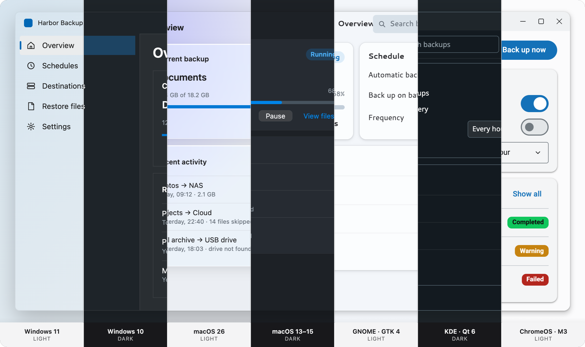
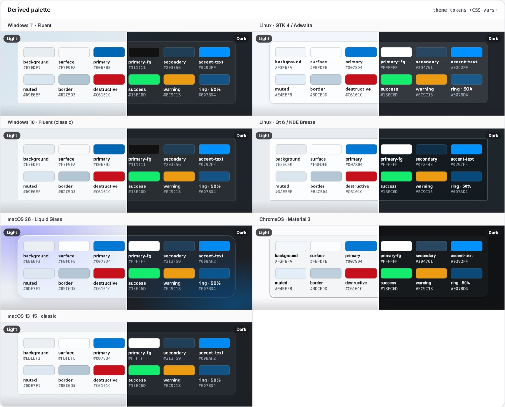
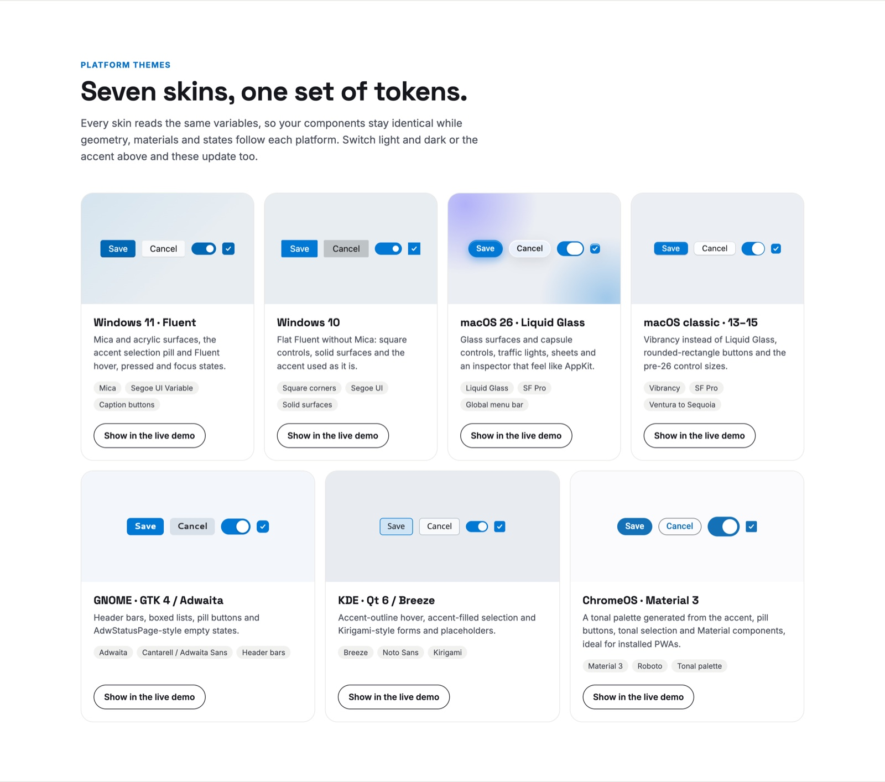
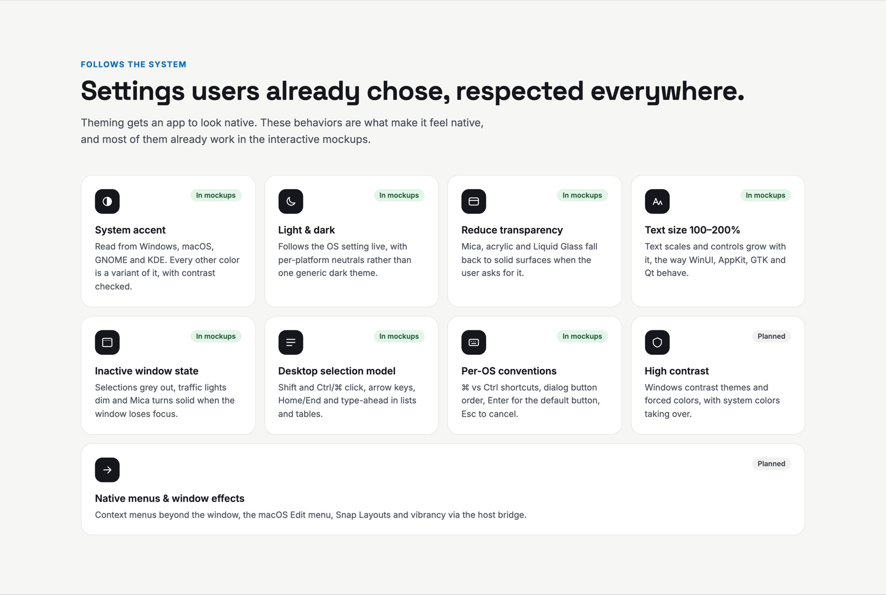
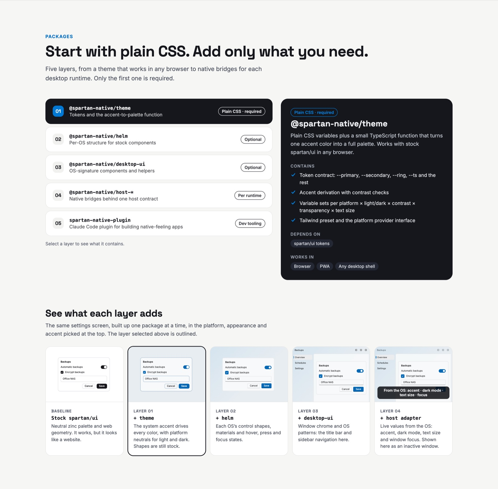
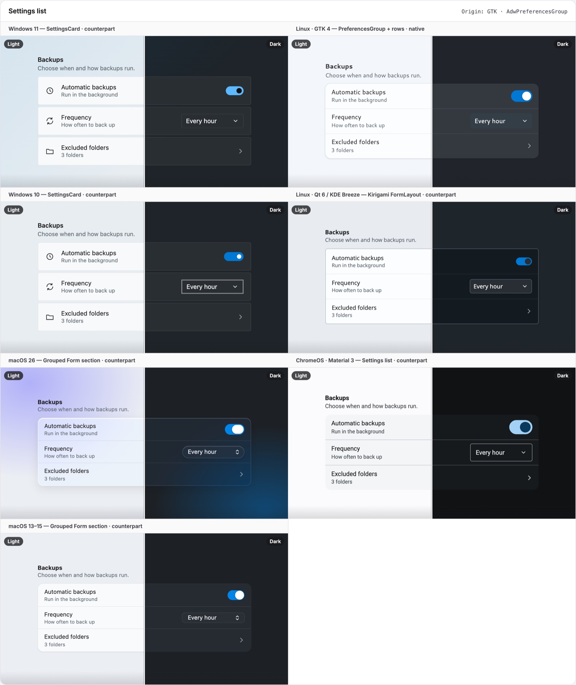
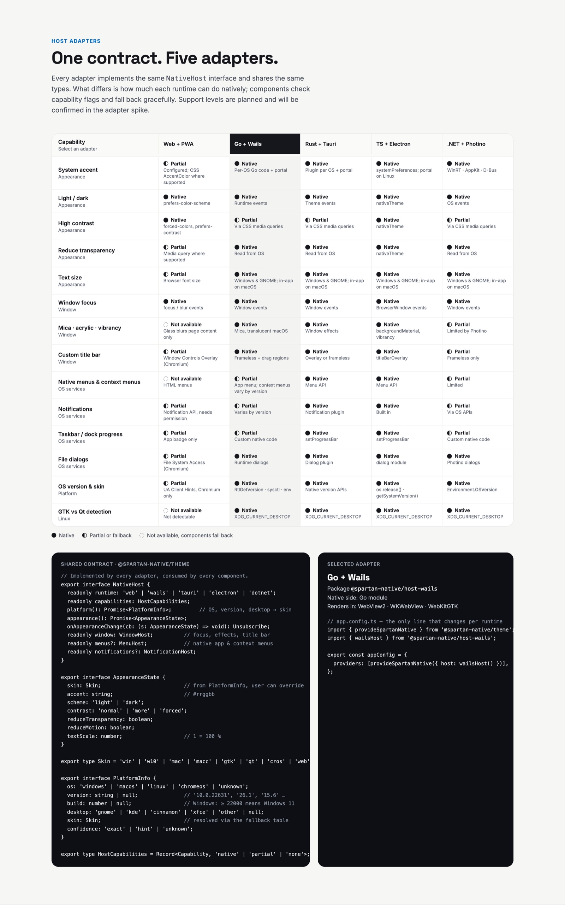
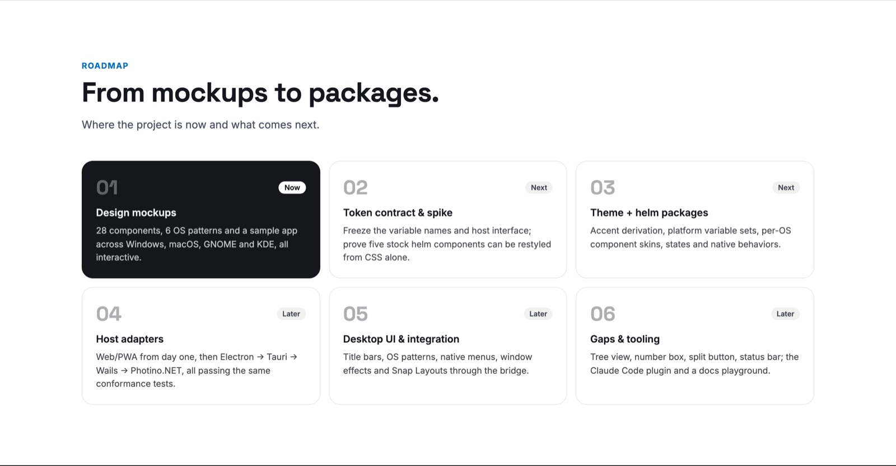

# Spartan Native

[](https://github.com/Spartan-Native/spartan-native/actions/workflows/ci.yml)
[](https://www.npmjs.com/package/@spartan-native/theme)
[](LICENSE)

**Native on every desktop. One Angular codebase.**



<sub>The same app window, unchanged, in all seven skins: Windows 11 · Windows 10 · macOS 26 · macOS 13–15 · GNOME · KDE · ChromeOS, alternating light and dark. Rendered from the design mockups.</sub>

Spartan Native is a native-look theme for [spartan/ui](https://spartan.ng) (Angular). It does not fork spartan. Your components stay the same and read one shared set of CSS variables. A **skin** changes their geometry, materials and states to match each OS, and a **host adapter** feeds in the settings the user already chose in the OS: accent color, light/dark, contrast, transparency, text size and window focus. The same app runs in a browser/PWA and in Wails, Tauri, Electron or Photino.NET. Only one line of `app.config.ts` changes per runtime.

## Status

| Package | State | Lives in |
| --- | --- | --- |
| [`@spartan-native/theme`](packages/theme) | Implemented for all seven skins | this repository |
| [`@spartan-native/helm`](packages/helm) | Selection model, default/cancel buttons, dialog button order | this repository |
| [`@spartan-native/desktop-ui`](packages/desktop-ui) | Window chrome, the six OS patterns, status bar, split button, number box, tree view, menubar adapter | this repository |
| [`@spartan-native/host-web`](packages/hosts/host-web) | Implemented: browsers and installable PWAs | this repository |
| [`@spartan-native/host-conformance`](packages/hosts/host-conformance) | Implemented: the test suite every adapter must pass | this repository |
| `@spartan-native/host-wails` | Implemented, runs the sample app as a Wails desktop app | [`Spartan-Native/host-wails`](https://github.com/Spartan-Native/host-wails) |
| `@spartan-native/host-tauri` | Implemented, passes the conformance suite; not yet tried in a real app window | [`Spartan-Native/host-tauri`](https://github.com/Spartan-Native/host-tauri) |
| `@spartan-native/host-dotnet` | Implemented for Photino.NET, passes the conformance suite; not yet tried in a real app window | [`Spartan-Native/host-dotnet`](https://github.com/Spartan-Native/host-dotnet) |
| `@spartan-native/host-electron` | Planned (not published) | [`packages/hosts/host-electron`](packages/hosts/host-electron) |
| Harbor Backup | Sample app: browser, PWA and Wails desktop | [`Spartan-Native/harbor`](https://github.com/Spartan-Native/harbor) |

The project is before `1.0`: a minor version may still contain breaking changes (see the [changelog](CHANGELOG.md)). What comes next is in the [roadmap](docs/09-roadmap.md).

## Quick start

Requires Angular 22+, Tailwind CSS 4 and spartan/ui (`@spartan-ng/brain` 1.9+).

```bash
npm install @spartan-native/theme @spartan-native/helm @spartan-native/desktop-ui @spartan-native/host-web
```

```ts
// app.config.ts
import { provideSpartanNative } from '@spartan-native/theme';
import { webHost } from '@spartan-native/host-web';

export const appConfig: ApplicationConfig = {
  providers: [provideSpartanNative({ host: webHost() })],
};
```

```scss
// src/theme.scss, listed after src/styles.css (Tailwind + the spartan preset) in angular.json "styles"
@use '@spartan-native/theme/styles/spartan-native';
@use '@spartan-native/helm/styles/spartan-native-helm';
```

Your stock spartan/ui components now follow the OS. The [theme README](packages/theme) explains the rest of the API. The full setup for every runtime, as a guide an agent can follow too, is in [`tools/claude-plugin`](tools/claude-plugin/skills/spartan-native/references/setup.md).

---

## Concepts

### 1. One accent → every color

Everything starts from a single input: the **system accent color**. `derivePalette()` mixes it with each platform's own light and dark neutrals. Text colors are then adjusted until they reach WCAG 4.5:1 contrast, and semantic colors (error, success, warning) borrow the accent's saturation. Change the accent in the OS and the whole app follows.



→ [Theme tokens & accent derivation](docs/03-theme-tokens.md)

### 2. Seven skins, one set of tokens

Every skin reads the same variables, so components stay identical while geometry, materials and states follow the platform: Fluent's Mica and acrylic on Windows 11, flat square controls on Windows 10, Liquid Glass capsules on macOS 26, vibrancy on macOS 13–15, Adwaita on GNOME, Breeze on KDE, and a Material 3 tonal palette on ChromeOS. A skin is a class on the document root (`t-win`, `t-mac`, …), combined with `dark`, `rt` (reduced transparency) and `inactive` (window not focused).



→ [Platform skins](docs/04-platform-skins.md) · [Components](docs/05-components.md)

### 3. Settings users already chose, respected everywhere

Theming makes an app *look* native. These behaviors make it *feel* native: live light/dark switching, solid surfaces when the user reduces transparency, text sizes from 100 to 200% with controls that grow, greyed-out selections when the window loses focus, the desktop selection model (Shift/Ctrl/⌘-click, arrow keys, type-ahead), and per-OS conventions such as ⌘ vs Ctrl, dialog button order and Enter/Esc.



### 4. Start with plain CSS, add only what you need

The project is five layers. Only the first is required. Each one builds on the layer below, so an app can stop at plain CSS in a browser or go all the way to native window effects.



| # | Package | What it adds |
| --- | --- | --- |
| 01 | [`@spartan-native/theme`](packages/theme) | Tokens, `derivePalette()`, the `NativeHost` contract, `provideSpartanNative()`. **Required.** |
| 02 | [`@spartan-native/helm`](packages/helm) | Desktop behaviors: the list/table selection model, default (Enter) and cancel (Esc) buttons |
| 03 | [`@spartan-native/desktop-ui`](packages/desktop-ui) | Window chrome and OS signature patterns spartan doesn't have |
| 04 | [`@spartan-native/host-*`](packages/hosts) | Bridges to the real OS settings, one per runtime |
| 05 | [`spartan-native` plugin](tools/claude-plugin) | Claude Code plugin that applies the conventions automatically |

→ [Architecture & packages](docs/02-architecture.md)

### 5. OS patterns and their counterparts

Each OS has signature patterns, such as Windows' CommandBar, the macOS Sheet and Inspector, and GNOME's PreferencesGroup and StatusPage. `desktop-ui` builds each pattern once. It renders natively on its home OS and as the closest equivalent everywhere else.



→ [OS patterns](docs/06-os-patterns.md)

### 6. One contract, five runtimes

Every runtime adapter implements the same `NativeHost` interface. Each adapter reports what its runtime can do as `native`, `partial` or `none` for every capability. Components check these flags and fall back gracefully, so the theme and components never know which runtime they're in.

```ts
// app.config.ts: the only line that changes per runtime
import { provideSpartanNative } from '@spartan-native/theme';
import { wailsHost } from '@spartan-native/host-wails';   // or webHost, tauriHost, electronHost, dotnetHost

export const appConfig = {
  providers: [provideSpartanNative({ host: wailsHost() })],
};
```



→ [Host contract & adapters](docs/07-host-adapters.md)

### Roadmap



→ [Roadmap & milestones](docs/09-roadmap.md) · [Open questions](docs/10-open-questions.md)

---

## Contributing

Setup, the workspace layout, commands and release steps are in [CONTRIBUTING.md](CONTRIBUTING.md). Please read the [code of conduct](CODE_OF_CONDUCT.md), and report security problems as described in [SECURITY.md](SECURITY.md).

## Docs

| | |
| --- | --- |
| [Overview](docs/01-overview.md) | [Architecture](docs/02-architecture.md) |
| [Tokens & palette](docs/03-theme-tokens.md) | [Platform skins](docs/04-platform-skins.md) |
| [Components](docs/05-components.md) | [OS patterns](docs/06-os-patterns.md) |
| [Host adapters](docs/07-host-adapters.md) | [Sample app](docs/08-sample-app.md) (in the harbor repository) |
| [Roadmap](docs/09-roadmap.md) | [Open questions](docs/10-open-questions.md) |

<sub>Images are rendered from the design canvas "Spartan Native Theme — Wails" (`docs/reference/design-source/`) with the scripts in `docs/reference/screenshot-tools/`. Platform names are trademarks of their respective owners.</sub>

## License

[MIT](LICENSE). The stock spartan/ui components in `libs/spartan-ui` are MIT-licensed by their authors; see [NOTICE](NOTICE). Platform names are trademarks of their respective owners, and Spartan Native is not affiliated with or endorsed by any of them.
