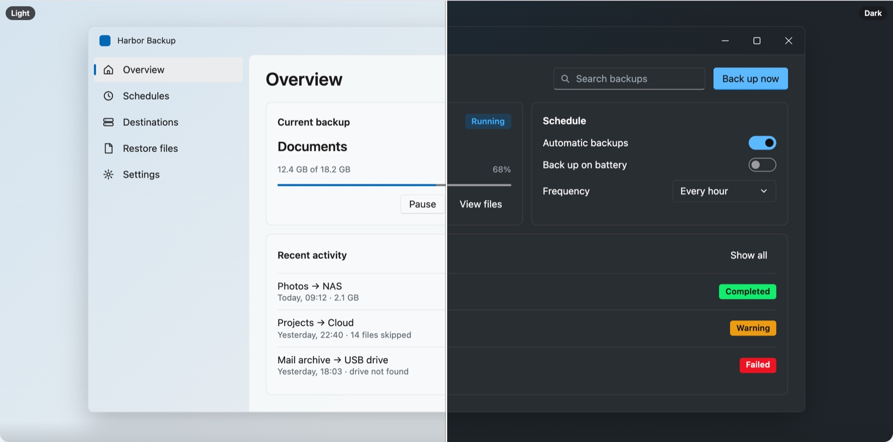
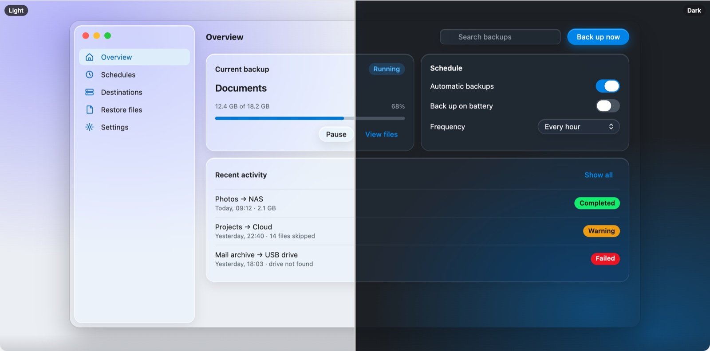
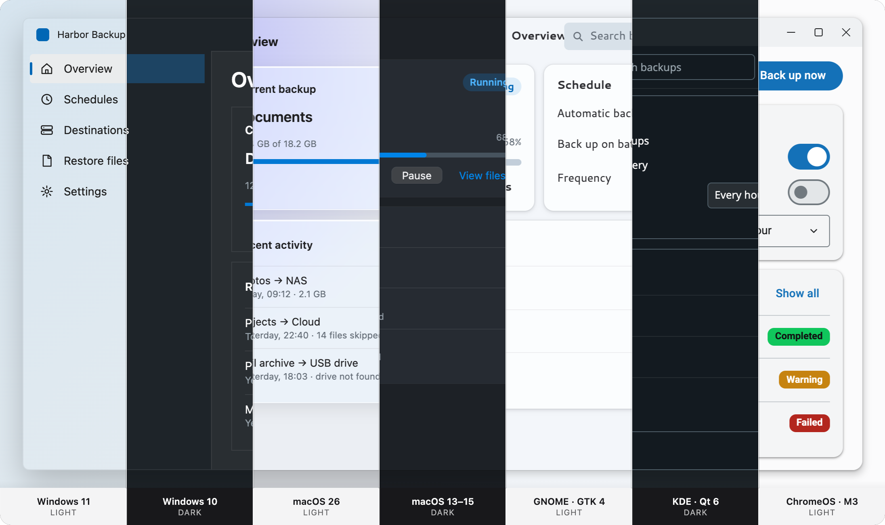

# Harbor Backup sample app

The reference app from [`08-sample-app.md`](../../docs/08-sample-app.md): sidebar navigation, a backup status card, a schedule card and recent activity. It is the end-to-end acceptance test: it must run with `host-web` in the browser and with `host-wails` in Wails, with only `app.config.ts` differing.

> Status: **the main window works** on Windows 11, macOS 26 and GNOME, built from stock spartan/ui components and `@spartan-native/theme`. It runs on `webHost()`: the browser's accent, light/dark, contrast, transparency, text size and window focus flow in live. The dev bar shows what the OS reports and can override the skin and scheme ("Follow system" drops the overrides). The app has its own Storybook (`npm run storybook:harbor`, port 6010) with the theme toolbar plus text size and window focus.

| File | What it is |
| --- | --- |
| `src/app/harbor/harbor-window.*` | The window: sidebar, header, backup/schedule/activity cards, per-OS window chrome |
| `src/app/app.ts` | Wallpaper stage + dev bar (system readout, overrides) |
| `src/app/app.config.ts` | `provideSpartanNative({ host: webHost() })` |

```bash
npx ng serve harbor-backup
npx ng build harbor-backup
```

## Target design





The same window on all seven skins:



## Install as an app (PWA)

Harbor is an installable Progressive Web App: a manifest with its own icon set (including maskable icons), and a service worker for offline use in production builds.

1. `npm run start:harbor` and open http://localhost:4200 in Chrome or Edge.
2. Click **Install** in the address bar (or ⋮ → *Cast, save and share* → *Install page as app*).

| Running as | Frame | What Harbor draws |
| --- | --- | --- |
| Browser tab | the browser's | the full mock window on a wallpaper (a demo of the skins) |
| Installed | the OS title bar | no chrome of its own; it fills the window |
| Installed, title bar overlay (`display_override: window-controls-overlay`) | the OS draws only the window buttons | its own title bar in the `env(titlebar-area-*)` area, as a drag region |

In an installed window, toggle the title-bar overlay from the app's title-bar menu (the chevron next to the window buttons). Harbor follows the change live: `watchDisplayMode()` from `@spartan-native/host-web` drives the `frame` input of `HarborWindow`.

**Why install:** Chromium hides the OS accent from regular tabs (it answers a fixed blue), but installed apps can receive the real one. Once it does, the dev bar stops saying "accent hidden by this browser" and the theme follows your system accent.

**Service worker:** it is registered in production builds only (`ng build harbor-backup`; serve `dist/harbor-backup/browser` from any static server on localhost or HTTPS). Chrome doesn't need it to install the app, so the dev server installs fine too.

| File | What it is |
| --- | --- |
| `public/manifest.webmanifest` | Name, colors, `display_override`, icons |
| `public/icons/` | `icon.svg` (source), PNGs 72–512, maskable 192/512, Apple touch icon, favicon |
| `ngsw-config.json` | Service worker caching (Angular) |
| `src/app/pwa/window-mode.ts` | `injectDisplayMode()`: browser tab / installed / overlay as a signal |

