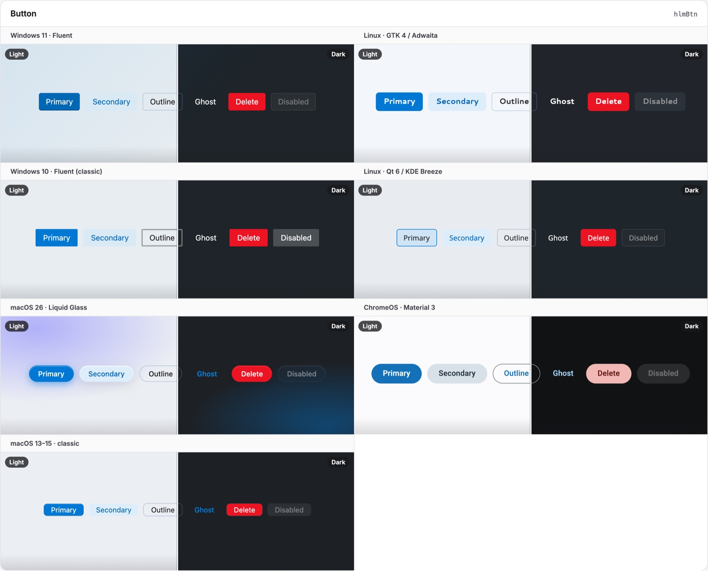

# Playground

One window built from stock spartan/ui and `@spartan-native/desktop-ui` components, with the controls to look at it as each OS: skin, light or dark, any accent, reduced transparency, and an inactive window.

```bash
npm start            # ng serve playground → http://localhost:4200
npx ng build playground
```

It runs on `webHost()`, so it starts from this browser's own OS settings. The controls change them through `SpartanNativeTheme.override()`, the API an app's own settings screen uses, and **Follow the system** drops the overrides again. The overrides are kept between reloads (`persist`).

The window shows a title bar, a command bar, a settings group (whose system-tray row becomes "Show in menu bar" on macOS through `*snPlatformIf`), the button variants, and, after **Delete all**, a status page. For every component on every skin side by side, use the Storybooks (`npm run storybook:theme`, `:helm`, `:desktop-ui`).


