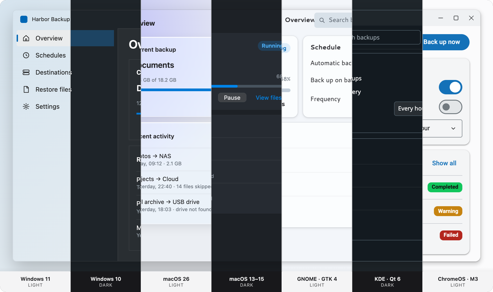

# Spartan Native: design documentation

Spartan Native is a native-look theme for [spartan/ui](https://spartan.ng) (Angular). One Angular codebase follows the system accent, light/dark, contrast, transparency and text size, and looks at home on Windows 11 and 10, macOS 26 and 13–15, GNOME, KDE and ChromeOS. It runs in the browser or as a PWA, and in desktop shells (Wails, Tauri, Photino.NET; Electron is planned).

These documents explain **why** the packages work the way they do: the design each package was built from, the rules behind the skins, and the contract between the UI and the runtimes. To **use** the packages, start with the [root README](../README.md) and each package's README. Each document says at the top whether it describes what is built or is a design specification for something still open.

## Reading order

| # | Doc | What it answers |
| --- | --- | --- |
| 01 | [Overview & scope](01-overview.md) | Goals, platforms, the native behaviors, what is in or out of scope |
| 02 | [Architecture & packages](02-architecture.md) | The five package layers, their dependencies, the Angular wiring |
| 03 | [Theme tokens & accent derivation](03-theme-tokens.md) | The CSS variables and the algorithm that builds every color from one accent |
| 04 | [Platform skins](04-platform-skins.md) | The seven skins: fonts, metrics, materials, inactive-window and reduced-transparency rules |
| 05 | [Components](05-components.md) | The spartan/ui components the skins restyle, and the desktop interaction rules |
| 06 | [OS patterns](06-os-patterns.md) | Six signature OS patterns and their counterparts on each platform (`desktop-ui`) |
| 07 | [Host contract & adapters](07-host-adapters.md) | The `NativeHost` interface, the adapters and the capability matrix |
| 08 | [Sample app: Harbor Backup](08-sample-app.md) | The reference app that tests everything end to end (in its own repository) |
| 09 | [Roadmap](09-roadmap.md) | What is done and what is left |
| 10 | [Open questions](10-open-questions.md) | Design decisions, made and still open |

## Images and design sources

`images/` holds the screenshots used by the READMEs. They were rendered from the original design mockups.

[`reference/`](reference/) is an **archive** of those mockups: the exported artboards (`design-source/`), their extracted CSS and the first TypeScript port of their color code. The packages have replaced all of it, and nothing in the build or the tests reads it. It is kept for the history of the design decisions. The screenshot scripts in `reference/screenshot-tools/` need the mockups' design runtime, which is not in this repository, so they cannot be run from a clone.
