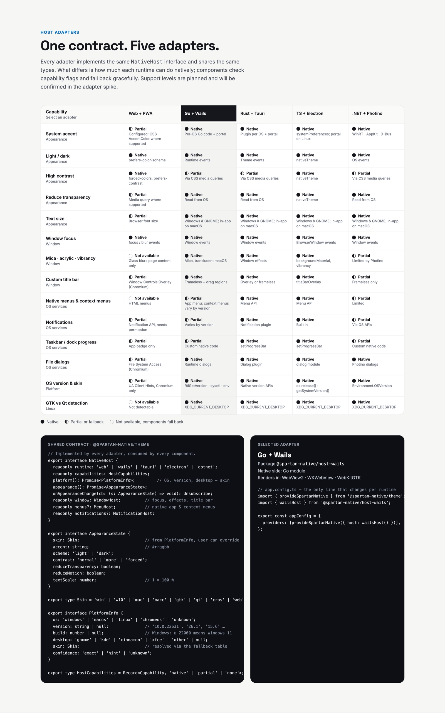

# Host adapters (`packages/hosts`)

**Layer 04.** Each adapter implements the `NativeHost` contract from [`@spartan-native/theme`](../theme), so the theme and components never know which runtime they are in. Only the host line in `app.config.ts` changes per runtime.

> Status: **`host-web`, `host-wails`, `host-tauri`, `host-dotnet` and `host-conformance` are implemented.** Electron is still a scaffold. The Wails, Tauri and Photino.NET adapters live in their own repositories, each with its native side at the same version. Spec: [`07-host-adapters.md`](../../docs/07-host-adapters.md).

| Package | Runtime | Native side | Factory |
| --- | --- | --- | --- |
| [`@spartan-native/host-web`](host-web) | Browser / PWA | none (browser APIs) | `webHost()` |
| `@spartan-native/host-wails` ([`Spartan-Native/host-wails`](https://github.com/Spartan-Native/host-wails)) | Go + Wails | Go module `github.com/spartan-native/host-wails` (same repository, same version) | `wailsHost()` |
| `@spartan-native/host-tauri` ([`Spartan-Native/host-tauri`](https://github.com/Spartan-Native/host-tauri)) | Rust + Tauri v2 | Rust crate `tauri-plugin-spartan-native` (same repository, same version) | `tauriHost()` |
| [`@spartan-native/host-electron`](host-electron) | TypeScript + Electron | `native/` main process + preload | `electronHost()` |
| `@spartan-native/host-dotnet` ([`Spartan-Native/host-dotnet`](https://github.com/Spartan-Native/host-dotnet)) | .NET + Photino.NET | NuGet package `SpartanNative.Photino` (same repository, same version) | `dotnetHost()` |
| [`@spartan-native/host-conformance`](host-conformance) | — (private) | — | `runHostConformance()` |

Built so far: web/PWA, Wails, Tauri and Photino.NET; Electron is next. Every adapter must pass `host-conformance`. Angular project names stay short (`ng build host-web`), and build output stays at `dist/host-*`.

