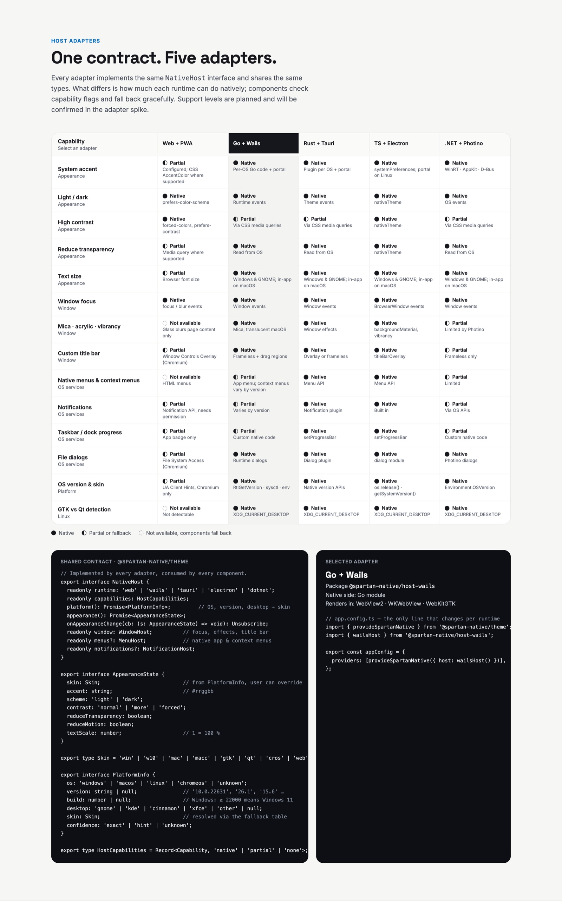

# @spartan-native/host-dotnet

**Layer 04 · host adapter for .NET + Photino.NET.** It implements the `NativeHost` contract from `@spartan-native/theme`, so the theme and components never know which runtime they are in. Renders in WebView2 · WKWebView · WebKitGTK.

> Status: scaffold. No implementation yet. Spec: [`07-host-adapters.md`](../../../docs/07-host-adapters.md) (contract and capability matrix).

## Contract and capabilities

The highlighted column in the design shows Wails; every adapter fills in its own column of this matrix.



## Usage (planned)

```ts
// app.config.ts: the only line that changes per runtime
import { provideSpartanNative } from '@spartan-native/theme';
import { dotnetHost } from '@spartan-native/host-dotnet';

export const appConfig = {
  providers: [provideSpartanNative({ host: dotnetHost() })],
};
```

## Structure

| Path | Purpose |
| --- | --- |
| `src/lib/` | TypeScript side of the adapter: `dotnetHost()` returning a `NativeHost`, with its capability flags. |
| `native/` | Native side: C# library for Photino.NET. Not part of the npm package. |
| `src/public-api.ts` | The package entry point. |

## Requirements

- Must pass `@spartan-native/host-conformance`.
- Capabilities the runtime cannot provide are reported as `'none'` or `'partial'`, never thrown.

## Commands

```bash
npx ng build host-dotnet
npx ng test host-dotnet
```
