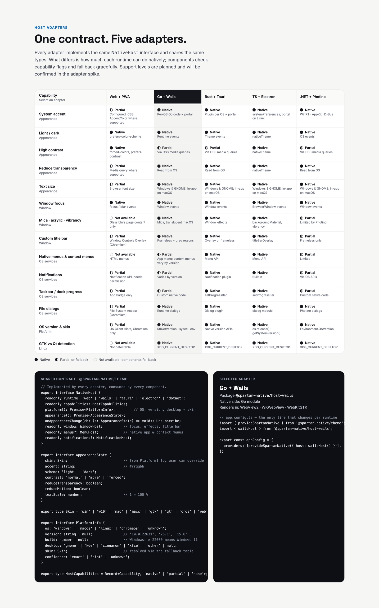

# @spartan-native/host-electron

**Layer 04 · host adapter for TypeScript + Electron.** It implements the `NativeHost` contract from `@spartan-native/theme`, so the theme and components never know which runtime they are in. Renders in bundled Chromium.

> Status: scaffold. No implementation yet, and not published to npm until there is one. Spec: [`07-host-adapters.md`](https://github.com/Spartan-Native/spartan-native/blob/main/docs/07-host-adapters.md) (contract and capability matrix).

## Contract and capabilities

The highlighted column in the design shows Wails; every adapter fills in its own column of this matrix.



## Usage (planned)

```ts
// app.config.ts: the only line that changes per runtime
import { provideSpartanNative } from '@spartan-native/theme';
import { electronHost } from '@spartan-native/host-electron';

export const appConfig = {
  providers: [provideSpartanNative({ host: electronHost() })],
};
```

## Structure

| Path | Purpose |
| --- | --- |
| `src/lib/` | TypeScript side of the adapter: `electronHost()` returning a `NativeHost`, with its capability flags. |
| `native/` | Native side: Main-process module + preload script. Not part of the npm package. |
| `src/public-api.ts` | The package entry point. |

## Requirements

- Must pass `@spartan-native/host-conformance`.
- Capabilities the runtime cannot provide are reported as `'none'` or `'partial'`, never thrown.

## Commands

```bash
npx ng build host-electron
npx ng test host-electron
```
