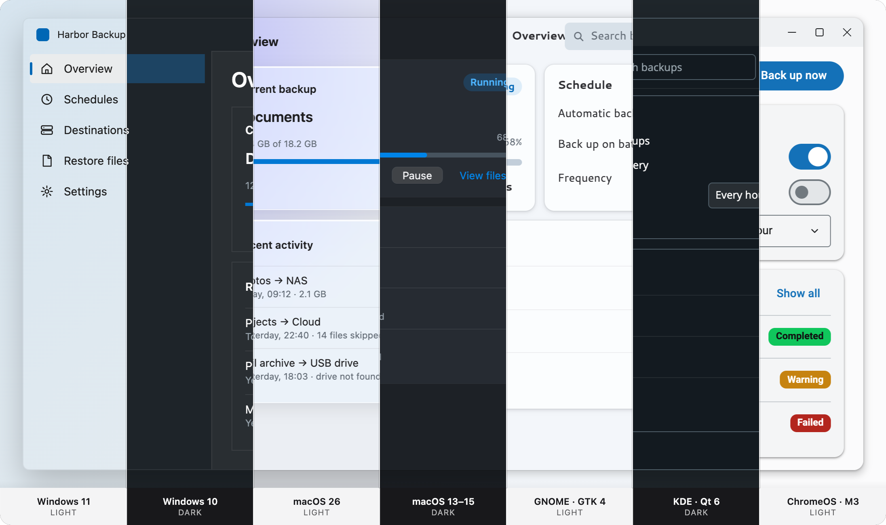

# @spartan-native/theme

**Layer 01 · required.** Makes stock spartan/ui components follow the system accent, light/dark, text size, transparency and window focus, and look at home on **Windows 11 and 10**, **macOS 26 and 13–15**, **GNOME (GTK 4 / Adwaita)**, **KDE Plasma (Breeze)** and **ChromeOS (Material 3)**.

> Status: **implemented for every skin**: Windows 11, Windows 10, macOS 26, macOS 13–15, GNOME, KDE Plasma and ChromeOS. Only the generic `web` fallback has no style sheet of its own. Spec: [`03-theme-tokens.md`](../../docs/03-theme-tokens.md), [`04-platform-skins.md`](../../docs/04-platform-skins.md).



## Use it

```ts
// app.config.ts
import { provideSpartanNative, staticHost } from '@spartan-native/theme';

export const appConfig: ApplicationConfig = {
  providers: [
    provideSpartanNative({ host: staticHost({ skin: 'mac' }) }), // later: webHost(), wailsHost(), …
  ],
};
```

```jsonc
// angular.json → build.options.styles: Tailwind + spartan preset first, then the theme
"styles": ["src/styles.css", "src/theme.scss"]
```

```scss
// src/theme.scss: resolved by package name
@use '@spartan-native/theme/styles/spartan-native';
```

```ts
// anywhere: the live appearance as signals
const theme = inject(SpartanNativeTheme);
theme.skin();                       // 'win' | 'mac' | 'gtk' | …
theme.override({ scheme: 'dark' }); // e.g. from an in-app settings screen
theme.followSystem();               // back to the OS values
```

Without Angular (or before bootstrap), `applySpartanNative(element, appearance)` does the same on any element. The static palettes in `contract/_palette-defaults.scss` make it work as plain CSS too: `<html class="t-gtk dark" data-sn-skin="gtk">`.

## How it works

1. **`derivePalette()`** turns one accent color into every color token (`--sn-color-*`), with per-platform neutrals and WCAG contrast checks.
2. **`applySpartanNative()`** writes them inline on the root, plus the classes `t-<skin>`, `dark`, `rt` (reduce transparency), `inactive` (window not focused), `hc` and `reduce-motion`.
3. **The SCSS** maps the tokens onto spartan's variable names, so stock components pick up the colors. Then each skin restyles the components' shape, materials and states.

All CSS lives in one cascade layer, `spartan-native`, ordered **after** Tailwind's `utilities`. Skins beat spartan's utility classes without `!important`, and your own unlayered CSS still beats the skins.

## Style structure

```
styles/                          published as @spartan-native/theme/styles/*
├── spartan-native.scss          entry: layer order + imports, in order
├── _layers.scss                 @layer theme, base, components, utilities, spartan-native
├── _hooks.scss                  the ONLY file that knows spartan's markup (data-slot selectors)
├── _functions.scss              px(32) → 2rem: sizes that grow with the OS text size
├── contract/
│   ├── _tokens.scss             every non-color token with its default
│   ├── _spartan-bridge.scss     --sn-* → --background, --primary, --radius, … (spartan names)
│   └── _palette-defaults.scss   GENERATED static palettes (npm run theme:palette)
├── base/
│   ├── _root.scss               text scale (rem = 16px × scale), platform font on body, arrow cursor
│   ├── _materials.scss          .sn-window .sn-sidebar .sn-content .sn-glass .sn-list-item .sn-chrome
│   ├── _tones.scss              .sn-tone-success / -warning / -danger / -accent (tints on hlmAlert)
│   └── _states.scss             .rt, .hc, forced-colors, .reduce-motion
└── skins/
    ├── win11/                   .t-win
    ├── win10/                   .t-win.t-w10   variant: _tokens + _components override win11
    ├── macos26/                 .t-mac
    ├── macos-classic/           .t-mac.t-macc  variant: _tokens + _components override macos26
    ├── gtk/                     .t-gtk
    ├── kde/                     .t-qt          full skin, same layout as gtk/
    └── chromeos/                .t-cros        full skin, same layout as gtk/
        ├── _index.scss
        ├── _tokens.scss         only the values that differ from the contract
        ├── _window-states.scss  focus ring + inactive window
        └── components/          one partial per component
            _button  _text-field  _checkbox-radio  _switch  _slider
            _progress  _tabs  _card  _badge
            _menu (dropdown menu + select list)  _dialog (dialog + alert dialog)  _tooltip
            _alert  _table  _field (field text, invalid inputs, separator)
```

### Reading an override

Every skin file has the same shape: tokens set the numbers, components read tokens, and selectors come from `_hooks.scss`.

```scss
// skins/win11/components/_button.scss
@layer spartan-native.skins {
  .t-win {
    // --- Accent button (variant="default") ---
    #{h.$button-primary} {
      background: var(--sn-color-primary);
      color: var(--sn-color-primary-fg);
      border-bottom-color: var(--sn-color-primary-edge);

      &:hover { background: color-mix(in srgb, var(--sn-color-primary) 90%, var(--sn-color-bg)); }
    }
  }
}
```

**Variant mapping:** spartan `outline` → the platform's *standard* button, `default` → accent / suggested action, `ghost` → flat / subtle.

### Adding a component skin

1. Add its selectors to `_hooks.scss` (prefer `data-slot`).
2. Add a size token to `contract/_tokens.scss` if it needs one, and its value in each `skins/*/_tokens.scss`.
3. Add `skins/<skin>/components/_<name>.scss` for each full skin (win11, macos26, gtk, kde, chromeos) and `@use` it from that skin's `_index.scss`. The variants (win10, macos-classic) inherit it; add an override to their `_components.scss` only where the platform differs.
4. Add it to a showcase in `src/stories/support/showcases.ts`.

The SCSS sits at the package root (`styles/`, not `src/styles/`), so the path is the same in the source and in the published package.

## Storybook

```bash
npm run storybook:theme   # http://localhost:6006
```

It shows only the **stock spartan/ui components**, themed:

| Control | Where |
| --- | --- |
| OS (Windows 11 · 10 · macOS 26 · 13–15 · GNOME · KDE · ChromeOS) | toolbar select, with an icon per platform |
| Reduce transparency · Increase contrast · Inactive window | toolbar switches (on / off) |
| Text size (100–200 %) | toolbar dropdown |
| Light / dark | Storybook's theme switcher (toolbar) |
| System accent | toolbar select with a swatch per preset, plus a picker for any color |

Stories (*Theme/Spartan components*, the skinned ones): **All components**, Buttons, Text fields & select, Switch/checkbox/radio, Slider/progress/tabs, Card & badges, Alerts, Table/separator/field, and **Menus, dialogs & tooltips** (an inline menu panel, plus a dropdown, select list, dialog, alert dialog and tooltips to open).

*Theme/Spartan catalog* uses every other component the spartan CLI generates (43 more, in `src/stories/support/catalog-*.ts`): combobox, autocomplete, native select, calendar, date picker, input group, OTP, kbd, toggle, toggle group, button group, menubar, breadcrumb, pagination, navigation menu, popover, hover card, context menu, sheet, drawer, toast, command, accordion, collapsible, avatar, item, empty, skeleton, spinner, typography, aspect ratio, scroll area, resizable, carousel, sidebar, message, bubble, message scroller, attachment, code block, marker, trace, questionnaire and chart. Most have no platform skin yet: they follow the palette, font and text size, and keep spartan's stock shapes.

### The `@spartan-native/theme/storybook` entry point

The same toolbar, accent control and decorator are published for any Storybook that uses the theme (helm, desktop-ui and the Harbor app use it too):

```ts
// .storybook/preview.ts
import type { Preview } from '@storybook/angular';
import { spartanNativePreview } from '@spartan-native/theme/storybook';

export default { ...spartanNativePreview({ textSize: true, windowFocus: true }) } satisfies Preview;
```

```ts
// .storybook/manager.tsx: draws the OS select, the switches and the accent picker
import '@spartan-native/theme/storybook/manager';
```

The toolbar addon is React (Storybook's manager UI), so it lives outside the Angular entry point, in `storybook/manager/`. This repo's four Storybooks import it by relative path. Each control appears only if the preview declares its global, so `windowFocus: false` hides the window switch.

`@storybook/angular` and `@storybook/addon-themes` are optional peer dependencies, needed only by this entry point.

## API

| Export | What it is |
| --- | --- |
| `provideSpartanNative({ host, overrides? })` | Angular providers; reads the host before first render |
| `SpartanNativeTheme` | Signals: `appearance`, `skin`, `scheme`, `textScale`, `focused`, `platform`, `overrides`, `followsSystem`; `override()`, `followSystem()`, `capability()` |
| `applySpartanNative(el, appearance)` | Framework-free: classes + variables on any element |
| `derivePalette({ skin, accent, scheme, reduceTransparency })` | The color algorithm |
| `paletteToCssVars(palette)` | `--sn-color-*` map |
| `resolveSkin(platformInfo)`, `skinClasses(skin)` | The OS → skin table |
| `staticHost(initial?)` | A code-controlled `NativeHost` for demos, tests and Storybook |
| `spartanNativePreview(options?)`, `withSpartanNative` | From `@spartan-native/theme/storybook`: the Storybook toolbar and decorator |
| `NativeHost`, `AppearanceState`, `PlatformInfo`, `HostCapabilities`, … | The host contract |

## Commands

```bash
npm run storybook:theme
npm run theme:palette      # regenerate contract/_palette-defaults.scss after changing derivePalette()
npx ng test theme          # 32 tests: contrast for every skin × scheme × swatch, skin table, DOM, service
npx ng build theme         # dist/theme, with styles/ (SCSS) included
```

### Visual regression

```bash
npm run test:visual                          # build the Storybooks, then compare screenshots (theme + desktop-ui)
npm run test:visual -- --project=theme       # only this package
npm run test:visual -- --update-snapshots    # accept an intended change (review the diff first)
npx playwright show-report dist/playwright-report
```

`e2e/visual.spec.ts` takes 91 screenshots: every skin in light and dark, with reduced transparency, more contrast,
an inactive window and 200 % text, plus the dropdown menu, select list, dialog, alert dialog and tooltip actually
opened. `e2e/catalog.spec.ts` adds 273 more: every catalog story on every skin in light and dark, plus each popup (combobox, autocomplete, date picker, menubar, navigation menu, popover, hover card, context menu, sheet, drawer, toast) opened. The tolerance is zero differing pixels. Baselines live in `e2e/__screenshots__/<platform>/`: fonts differ per
OS, so record them on the machine (or CI image) that checks them. On a new machine run `npx playwright install chromium` once.
